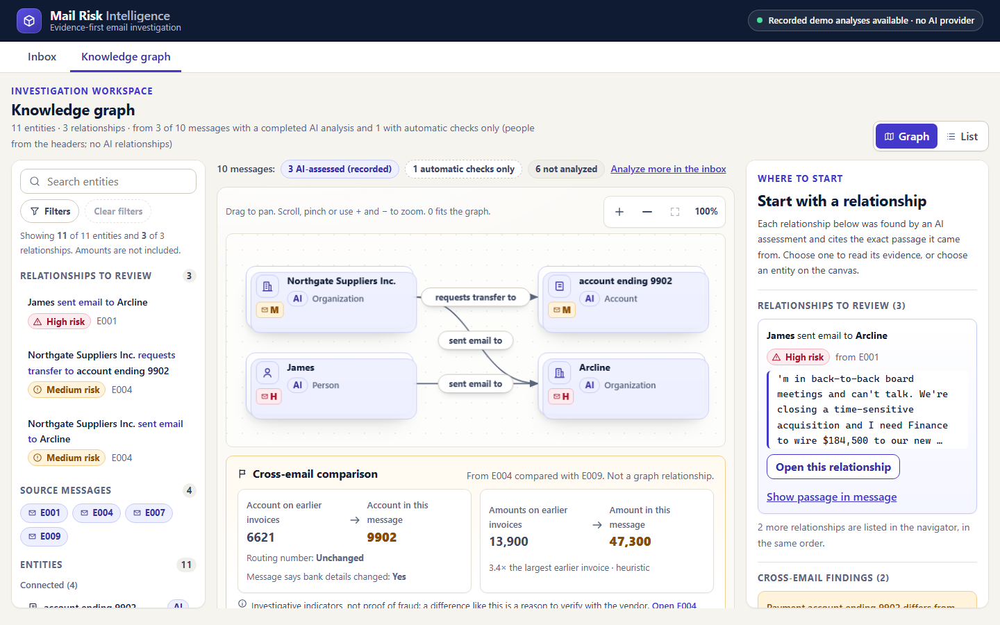
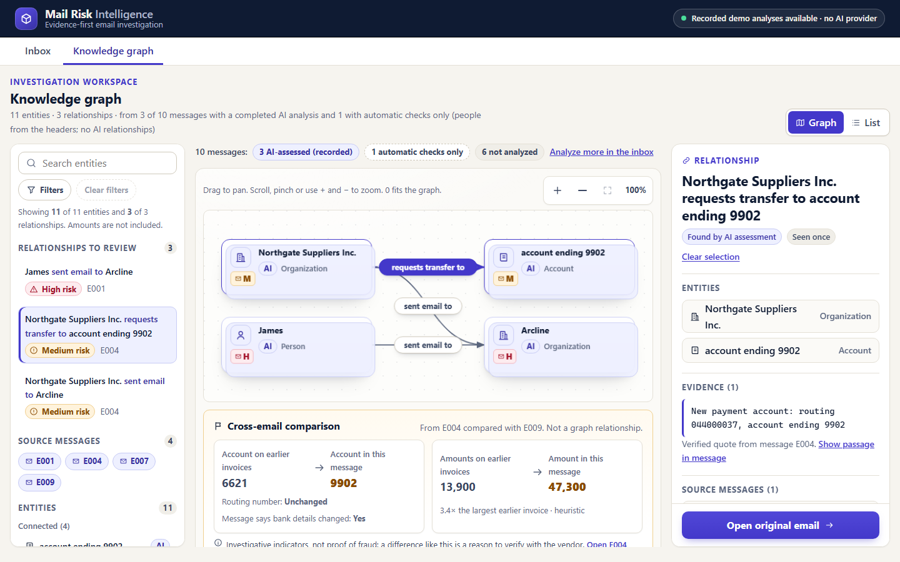
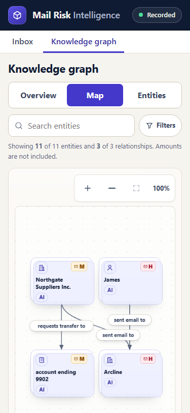
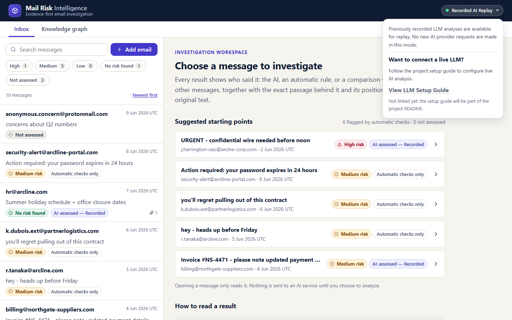

# Mail Risk Intelligence

A small full-stack tool for a (fictional) compliance team: emails and attachments land in a
mailbox, two chained LLM agents extract structured facts and assess risk, and an evidence-first UI
shows *who is involved, what they ask for, and the passage each AI finding cites*, with a clear
label for what the code verified and what is the model's own reading. A knowledge graph aggregates
entities and relationships across messages.

> **Synthetic data only.** The ten seed emails in `mock_mailbox_data.json` are fictional and were
> supplied with the assignment.



| Selecting a relationship | Narrow screen |
|---|---|
|  |  |

The screenshots are real captures of the running application in Recorded AI Replay mode
(see [the four modes](#the-four-analysis-modes)).

## Contents

1. [Key functionality](#key-functionality)
2. [Tech stack](#tech-stack)
3. [Architecture](#architecture)
4. [Quick start](#quick-start)
5. [The four analysis modes](#the-four-analysis-modes)
6. [Recorded AI Replay (no API key)](#recorded-ai-replay-no-api-key)
7. [Live LLM setup](#live-llm-setup)
8. [Rules-only fallback](#rules-only-fallback)
9. [Environment configuration](#environment-configuration)
10. [Supported inputs](#supported-inputs)
11. [Knowledge graph and evidence grounding](#knowledge-graph-and-evidence-grounding)
    (including [what is verified, and what is not](#what-is-verified-and-what-is-not))
12. [Testing](#testing)
13. [Security boundaries and limitations](#security-boundaries-and-limitations)
14. [Engineering decisions and tradeoffs](#engineering-decisions-and-tradeoffs)
15. [What I would improve with more time](#what-i-would-improve-with-more-time)
16. [Time spent](#time-spent)
17. [Further reading](#further-reading)

## Key functionality

- **Mailbox**: the ten seed emails are loaded on first start; add more by pasting raw text or
  uploading `.txt`, `.eml` or `.pdf` (same pipeline as the seed).
- **Two chained agents**: Agent A extracts a source-grounded summary, facts and evidence snippets;
  Agent B assesses risk and extracts entities and relationships from Agent A's output only.
- **Evidence first**: an AI risk level above "none" must cite at least one quote, and every
  entity-relationship cites one; the *code* locates each quote in the original message or
  attachment and checks it word for word. (A "none" assessment has nothing to cite.) A highlight is shown only where its position is
  proven. What the code does *not* prove is that the quote means what the AI says it means: see
  [What is verified, and what is not](#what-is-verified-and-what-is-not).
- **Honest states**: an unassessed message is never shown as safe; "No risk found" exists only
  for a message with a validated AI assessment.
- **Cross-email checks**: for example, E004 is compared with the earlier E009 invoice (payment
  account 6621 → 9902, amount $13,900 → $47,300, routing unchanged). It is presented as a lead,
  "not proof of fraud".
- **Knowledge graph**: entities and relationships across messages, with pan/zoom, filters,
  relationship selection, evidence links and a complete list view.
- **Failure handling**: model errors, timeouts and malformed output degrade a message to a
  clearly-labelled automatic-checks-only state instead of breaking the app.
- **Responsive and accessible UI**: master–detail on desktop, drill-down on narrow screens,
  Overview / Map / Entities for the graph, keyboard operation and visible focus.

## Tech stack

| Layer | Choice |
|---|---|
| Frontend | React 18 + TypeScript, Vite, **CSS Modules** with a small design-token file (no UI library) |
| Backend | Node ≥ 22.9 (see `.nvmrc`), Express 4, TypeScript (run with `tsx`) |
| Storage | SQLite via `better-sqlite3` behind a repository interface (an in-memory twin is used in most tests) |
| Ingestion | `postal-mime` for `.eml`, `unpdf` for text-layer PDFs, `multer` for uploads |
| Shared | an npm workspace (`shared/`) with the API types and zod schemas |
| LLM | one OpenAI-compatible Chat Completions client (a plain `fetch` client, no SDK) |
| Tests | Vitest (server, web), Testing Library + jsdom (web) |

**Why CSS Modules:** scoped styles with zero runtime and no extra dependency; the visual language
(risk colours, provenance chips, radii) lives in `web/src/styles/tokens.css` so it stays
consistent between the inbox, the detail view and the graph.

## Architecture

```
shared/        API types + zod schemas used by both sides
server/src/
  ingestion/   parse + normalize (txt / eml / pdf / seed) -> one NormalizedEmail
  agents/      Agent A (extraction), Agent B (risk + graph), prompts, JSON repair
  analysis/    orchestration, bounded queue, restart recovery, rules-only automatic checks
  risk/        deterministic indicators, aggregation, cross-email vendor checks, entity identity
  llm/         OpenAI-compatible client, configuration, observed-status tracker
  replay/      recorded-fixture client and the (operator-run) recorder
  storage/     repository interface, SQLite and in-memory implementations
  api/         thin Express layer, origin guard, error contract
web/src/       React app: inbox, investigation view, knowledge graph
fixtures/recorded/   three genuine recorded analyses (E001, E004, E007)
```

**Pipeline** (`server/src/analysis/service.ts`):

1. *Ingest* → a normalized email is stored (idempotent; duplicates are detected).
2. *Agent A* receives the email in delimited, untrusted blocks and returns JSON. Its quotes are
   located in the original text by code; unverifiable items are dropped.
3. *Agent B* receives **only** Agent A's validated output and returns the risk assessment,
   entities and relationships. A finding that cannot be tied to evidence is withheld.
4. *Outcome* is persisted: `complete` (both validated), `partial` (A only), `degraded` (code-only
   extraction) or `failed`. Only `complete` can carry a risk level, including "none".
5. At read time, deterministic indicators and cross-email findings are combined with the AI
   level. Rule-based signals are capped at *medium*; only a validated AI assessment can say
   *high*, and only a validated AI assessment can say *none*.

Analysis starts only on an explicit request (button or API call). Start-up never contacts a
provider unless `ANALYSIS_AUTOSTART=true`.

## Quick start

Prerequisites: **Node 22.9 or newer** (Node 24 is what `.nvmrc` pins) and npm.

```bash
git clone https://github.com/SaadAmaria/mail-risk-intelligence.git
cd mail-risk-intelligence
npm install
npm run dev
```

Open <http://localhost:5173>. That is the whole setup: with no `.env` and no API key the app
starts in [Recorded AI Replay](#recorded-ai-replay-no-api-key) mode. The ten seed messages are
loaded into `server/data/mail-risk.db` (created on first run).

- `npm run dev` starts the API on `127.0.0.1:3001` and the Vite dev server on `5173` (which
  proxies `/api`). If `3001` is taken, set `PORT` (shell or `.env`); the proxy follows it.
- If Vite must run on a port other than `5173`, add that origin to `CORS_ORIGIN`
  (see [Security](#security-boundaries-and-limitations)); otherwise adding an email or starting an
  analysis is refused with 403.
- `npm run build` type-checks and builds the frontend into `web/dist`. The API is run with
  `tsx` (`npm run dev:server`, or `npm run start -w server` without file watching); there is no
  separate compiled server bundle.

These commands were verified from a fresh clone of the repository (install, build, start with no
`.env`, seed load, replay of a recorded email, paste and `.eml` upload, graph and health
endpoints, full test suites). Installing took seconds on that machine; a first run on yours may
also build the native `better-sqlite3` module.

## The four analysis modes

The interface and API never blur these:

| Label in the UI | Meaning | Provider call? |
|---|---|---|
| **AI-assessed — Live** | A configured model analysed the message; both agents' output was validated. | Yes, on your explicit action |
| **AI-assessed — Recorded** | The stored result of a genuine earlier model run, replayed for the three recorded messages. | **No** |
| **Automatic checks only** | Deterministic rules ran (header and text signals, cross-email comparison). Not an AI assessment. | No |
| **Not assessed** | Nothing validated exists for this message. This is **not** "safe". | No |

Not every message has an AI assessment. In replay mode only **E001, E004 and E007** do; the
other seeded messages show automatic checks only until you run them with a live model.

## Recorded AI Replay (no API key)

With no live model configured and compatible recordings present, the header shows
**Recorded AI Replay**: *previously recorded LLM analyses are available for replay; no new AI
provider requests are made in this mode.*



- `fixtures/recorded/` holds recordings for E001 (CEO-style wire request, high), E004 (invoice with
  changed payment details, medium) and E007 (benign HR notice, no risk found). They were produced
  by a genuine run of both agents against Groq, using the operator's own Groq key at capture time
  (replaying them needs no key), then sealed with integrity hashes
  (`fixtures/recorded/index.json`); the loader refuses a fixture whose hash, email content or
  schema version no longer matches.
- Choose **Replay recorded analysis** on one of those messages. The recorded answer is run through
  the same validation as a live one. Nothing is sent to a provider.
- A message *without* a recording cannot be replayed. It offers **Run automatic checks**, which is
  rules-only and runs on the server with no path to any provider.
- Recordings are tied to the exact seed text and prompt version. Changing either makes them
  unusable (reported by `/api/health` under `replay.problems`); they are never regenerated silently.

## Live LLM setup

Live analysis is optional. **You need your own API key**; none is included in this repository.
(The replay recordings were captured once with the operator's own Groq key, as described above;
replaying them uses no key. An earlier version of this sentence said no key was used to produce
them, which contradicted that description and was wrong.) A free-tier Groq account may be enough
for a handful of messages, but check Groq's current limits and terms yourself.

1. Create an account at <https://console.groq.com> and create an API key there.
2. Create your local config: `cp .env.example .env` (on Windows: `copy .env.example .env`).
3. Edit `.env` and set exactly these three values:

   ```ini
   LLM_BASE_URL=https://api.groq.com/openai/v1
   LLM_MODEL=openai/gpt-oss-120b
   LLM_API_KEY=<your own key>
   ```

   `openai/gpt-oss-120b` is the model the recordings were made with and the one this project was
   exercised against. Verify it is still offered on your account. `.env` is git-ignored; never
   commit it.
4. Restart: stop the server and run `npm run dev` again.
5. Verify: open <http://127.0.0.1:3001/api/health> (your `PORT`). You should see
   `"llm": {"configured": true, "provider": "api.groq.com", ...}` and the header should no
   longer say *Recorded AI Replay*. Only the host and model are reported, never the key.

**Reading the status.** `configured: true` means the settings are valid, not that the provider is
reachable. `reachability` stays `"unchecked"` until a real call has happened, then reports what
was *observed* (`reachable`, `unreachable`, `credentials_rejected`). The health check itself never
calls the provider.

**What happens on failure.** A call is retried a bounded number of times
(`LLM_MAX_RETRIES`, default 2) with backoff; a provider-requested wait longer than about 20 s is
not honoured and the call fails as rate-limited. Authentication errors are not retried. If Agent A
fails, the message is stored as `degraded` (code-only extraction); if only Agent B fails it is
`partial`. Neither is ever shown as safe, and each can be retried (a few automatic retries, then an
explicit confirmation). Retry and 429 handling were verified against scripted responses; they were
never exercised against the real provider.

**Return to no-key replay mode.** Remove or blank `LLM_BASE_URL`, `LLM_MODEL` and `LLM_API_KEY`
in `.env` (or delete `.env`) and restart. Messages already analysed live keep their stored
result; a recording never replaces a finished live analysis.

**Free-tier or local model.** The assignment allows either; this project implements and was
exercised with **Groq's free tier**. Ollama and local models are **not implemented or tested**: the
client is a generic OpenAI-compatible Chat Completions client, so a compatible server might work,
but no support is claimed.

## Rules-only fallback

If no live model is configured, or a model call fails, the application keeps working with
deterministic checks: look-alike sender domains, urgency and secrecy language, payment-detail and
amount changes compared with earlier messages, and so on. These produce *indicators* with the
exact matching passage and are capped at **medium**. A rules-only message is labelled
*Automatic checks only* and its overall state remains *Not assessed* unless a validated AI
assessment exists.

`POST /api/emails/:id/automatic-checks` (the **Run automatic checks** button) stores such a
result explicitly. It is built without any LLM client, never replaces a completed AI analysis or
an AI extraction, is idempotent, and does not consume the AI retry allowance.

## Environment configuration

Copy `.env.example` to `.env`. Every variable is optional.

| Variable | Default | Purpose |
|---|---|---|
| `PORT`, `HOST` | `3001`, `127.0.0.1` | API port and bind address (keep loopback unless you mean it) |
| `DB_PATH` | `./data/mail-risk.db` | SQLite file, relative to `server/` |
| `SEED_PATH` | repo `mock_mailbox_data.json` | seed mailbox (read-only) |
| `REPLAY_DIR` | `fixtures/recorded` | recorded analyses (read-only) |
| `LLM_BASE_URL`, `LLM_MODEL`, `LLM_API_KEY` | unset | live model; **all three** are needed for a hosted endpoint |
| `LLM_REASONING_EFFORT` | `low` | `low`/`medium`/`high`/`none` (`none` omits the parameter) |
| `LLM_TIMEOUT_MS`, `LLM_MAX_RETRIES`, `LLM_MAX_COMPLETION_TOKENS` | `25000`, `2`, `3000` | per-call limits |
| `CORS_ORIGIN` | `http://localhost:5173,http://127.0.0.1:5173` | browser origins allowed to *change* data |
| `ORG_DOMAINS` | `arcline.com` | the organisation's own domains, for look-alike detection |
| `ANALYSIS_AUTOSTART` | `false` | `true` queues unanalysed mail at start-up (sends content to the provider if live) |
| `ANALYSIS_CONCURRENCY`, `ANALYSIS_MAX_RUNS`, `ANALYSIS_QUEUE_CAPACITY` | `1`, `3`, `200` | queue limits |

Invalid values never crash the server: they are reported (without secrets) in `/api/health` and
fall back to the default.

## Supported inputs

| Input | Support |
|---|---|
| Paste raw email text | A header block (`From:`, `To:`, `Subject:`, ...) followed by a body, or a plain body with the missing headers flagged |
| `.eml` | Parsed as MIME; text and PDF attachments are read into the same message |
| `.txt` | Same handling as pasted text |
| `.pdf` | The PDF itself is the message (for example a printed email). **Text-layer PDFs only**: a scanned, image-only PDF is rejected with an explicit "OCR is not supported" message |

Limits: 5 MB per upload, 200,000 characters kept per body or attachment, 30 PDF pages, a 15 s PDF
read budget. Anything over a limit is truncated and flagged, or refused, never silently dropped.

**What the AI reads is shorter than what is stored.** Agent A is sent at most the first 6,000
characters of the body and the first 3,000 characters of each of up to four attachments
(`DEFAULT_SEGMENT_LIMITS`); the clipping is recorded in the extraction notes. A "no risk found"
result therefore covers only the text the model was shown, not necessarily every stored passage.

## Knowledge graph and evidence grounding

The graph (`/graph`, `GET /api/graph`) is **derived at read time** from the stored analyses; it is
not a separate store.

- **Nodes** come from validated AI assessments plus people read from message headers
  (labelled *Automatic*).
- **Edges exist only where an AI assessment returned a relationship that passed validation**, and
  each cites a quote that was found in the message. The graph does not infer, guess or complete
  relationships. The *type* of each relationship ("threatens", "requests transfer to", ...) is the
  AI's reading of that quote; see the next section.
- **People merge across messages only on an identical e-mail address that the message itself
  ties to that person**: the name matches a header display name, or the text writes "Name
  <address>", "Name (address)" or "Name at address". An address that merely appears somewhere in the
  message, or that the AI attached to a name, is not enough. Names alone never merge, so two people
  called "James" stay separate. The rules favour a missed merge over a wrong one, but they are
  heuristics: a wrong merge is possible when a message itself states a misleading pairing.
- **Organizations** that differ only by punctuation or the long form of the legal suffix merge
  ("Acme Inc." = "ACME INCORPORATED"). If the data contains two different legal forms ("Acme Inc."
  and "Acme LLC") they stay separate, and a bare "Acme" is not guessed to be either.
- **Masked accounts** ("account ending 6621") are not identified by their last digits. They merge
  across messages only when they belong to the same organization *and* are described identically
  ("checking account ending 1234" with "checking account ending 1234"; a bare "account ending 6621"
  with a bare one). A bare and a described mention, or two descriptions, stay apart. A complete
  account number merges with the same number of the same organization. Because two accounts of one
  owner can still be described identically, a wrong merge remains possible.
- Entities with no relationship are shown in a separate "Not connected" collection, not hidden.
- A risk letter on an entity describes the *messages* it appears in, not the entity itself.
- The cross-email comparison (E004 vs E009) is a finding about stored messages and is shown beside
  the graph, never as an edge.
- With the three recordings and rules-only checks on E009, the real data is small: 11 entities
  and 3 relationships, including the shared Northgate sender node (E004 and E009). The
  account-change comparison is not a graph edge and is not drawn as one.

"Show passage in message" opens the email and highlights the cited text only when its position is
verified against the original; otherwise the quote is shown without a highlight.

### What is verified, and what is not

| Claim | Established by | Strength |
|---|---|---|
| The quote appears in the message or attachment, at this position | Code (exact text match against the stored original) | **Proven** |
| The entities named are in the message | Code (grounded in the extracted text, headers and facts) | **Proven** (presence, not meaning) |
| The relationship type fits the kinds of entity it connects | Code (a table of allowed endpoint types; impossible ones are dropped, also when read from older stored analyses) | **Checked** |
| The quote names the entities, in which order, and (for accusations) whether it contains wording of that kind and whether that wording is negated | Code, **read-time heuristic** (simple name matching and small English word lists) | **Advisory only**: it can flag "Check this quote"; it never removes a relationship and never proves one |
| The quote *means* the relationship type, or the risk level is right | The AI model | **Model-asserted**; not verified by code and not scored for accuracy |
| Two mentions are the same person, organization or account | Code (the conservative identity rules above) | **Checked, heuristic**; uncertain cases are kept apart, but a wrong merge is not excluded |

There is no second model that re-reads the claim, so semantic support is the model's judgement.
The English word lists are narrow and a threat in another language or in unusual phrasing is simply
not recognised (it is kept and flagged, not dropped). The interface says "Quote found in message",
never "verified relationship". The "Check this quote" advisory is shown, from the server's metadata,
in these places: the message's "Relationships the AI cited" list; the evidence view opened from the
graph; the graph's relationship inspector, entity inspector and featured "where to start"
relationship (as a note); and the graph navigator, start list and Graph List (as a "Check quote"
chip). On the canvas the relationship label carries it only in its accessible name and as a dashed
outline; the visible label text is unchanged. A quote with its own advisory gets the note under that
quote. A relationship flagged only as a whole (older stored payloads) gets one note for the
relationship. These places are covered by tests, but the list is not a guarantee that no other
view exists. A relationship without the advisory has **not** been proven; it only did not trip the
heuristic.

**Older stored analyses** are never rewritten. They are re-checked on read: a relationship that is
structurally impossible under the current rules is left out of the graph and counted
(`meta.excluded_relationships`), and every kept relationship is given the same advisory support
note. A relationship accepted under looser, earlier rules but structurally possible stays visible.

**Damaged stored records** do not take down the inbox, a message or the graph. A stored list that
cannot be read in full (recipients, Cc, missing-header names, notes) keeps its readable entries and is
reported on the message ("Some stored details could not be read"). A partial To or Cc line is marked
incomplete, and a line where nothing survived says "Could not be read", never "No recipients listed".
Nothing is filled in and nothing is written back.

## Testing

```bash
npm test            # server + web (Vitest)
npm run typecheck   # all workspaces
npm run build       # production build of the frontend
```

Last executed **by the author** (2026-10-12, Phase 9D delta): server 38 files / 701 tests, web 24
files / 281 tests, typecheck clean. The independent historical audit executed web 24 files / 281
tests and server 31 files / 563 tests. It collected all 701 server tests but did not run the seven
suites that write files (storage, seed, startup, analysis storage, analysis service, API recovery,
replay), so "701 passing" is the author's result, not an independent one. Tests use scripted fake LLM clients; **no test contacts a provider**. Most server
tests use the in-memory repository. Seven server test files use the real SQLite repository. Six of them use
temporary database files (analysis service, analysis storage, API recovery, seed, startup, storage),
and the corrupt-record tests use a `:memory:` SQLite database. Web tests stub `fetch` in jsdom.
They cover ingestion, both agents' validation and failure paths, orchestration and restart
recovery, risk aggregation, replay integrity, the HTTP API (including the origin guard), and the
React views. Several suites use deliberate mutation checks recorded in `docs/DECISIONS.md`. Those
are the author's records; the independent audit reproduced only selected ones (cancellation,
review-advisory rendering, filter metadata). One historical claim was corrected on 2026-10-12: the
relationship-grounding tests "failing on HEAD" (D98) failed because the module they import did not
exist yet, which is not a per-test regression result.

Real-browser checks (headless Edge, desktop and 320–768 px) were run during development against an
isolated backend; they are recorded in `PROCESS.md` but are not part of `npm test`.

## Security boundaries and limitations

This is an assignment-scale tool, **not production-secure**.

- **No authentication or authorization** (the brief excludes accounts). Anyone who can reach the
  port can read and change the mailbox. The server binds to loopback by default.
- **Origin guard.** State-changing requests (`POST`) are refused before any side effect unless
  the browser origin is allowed, and bodies must be JSON (multipart only for upload). This blocks a
  malicious web page from driving the API through your browser. It is *not* authentication: a
  non-browser client, a page on an allowed origin, or malware on the machine is not stopped.
- **Secrets.** The API key is read from the environment, never returned by the API, never logged and
  redacted from provider error text. `.env` is git-ignored.
- **Untrusted email content** is delimited and the model is instructed to treat it as data;
  outputs are schema- and evidence-validated. Prompt-injection resistance is mitigated, not
  guaranteed.
- **Privacy.** In live mode the text of an email you choose to analyse is sent to the configured
  provider. In replay and rules-only modes nothing leaves the machine. Data is stored unencrypted
  in a local SQLite file (`server/data/`, git-ignored).
- **Recorded fixtures** carry integrity hashes that detect accidental change, not a malicious one
  (anyone who can edit the files can also edit the hashes). They are real model output for
  synthetic mail.
- **Accuracy.** No detection accuracy is claimed or measured. Findings are leads for a human
  reviewer; the UI says so.
- **Before any public deployment** you would need at least: authentication and per-user
  authorization, TLS, a proper session/CSRF design, rate limiting, encrypted storage and a data
  retention policy, a job queue that survives restarts, audit logging, and a review of prompt
  injection and PDF-parsing exposure.

## Engineering decisions and tradeoffs

The full records, with alternatives and verification, are in
[`docs/DECISIONS.md`](docs/DECISIONS.md). The ones that matter most:

- **Evidence-snippet chain instead of free-text quotes.** The model quotes, code finds and verifies
  the position. Costs one more validation step; removes unverifiable highlights.
- **"None" only from validated AI.** Rules are capped at medium and an unassessed message is never
  "safe". Costs a more conservative inbox.
- **Cross-email intelligence and the graph are derived at read time.** No consistency problem
  between stored copies; costs recomputation on each read (fine at this size).
- **Replay at the `LlmClient` boundary.** Recorded answers go through exactly the same validation
  as live ones, so replay exercises the real pipeline. Costs: recordings are bound to the seed and
  prompt version.
- **One OpenAI-compatible client, no provider chain.** Simple and testable; no automatic failover.
- **Asynchronous processing with polling, in-process queue.** Enough here; it is lost on restart
  (interrupted jobs are recovered and *not* re-sent unless you allow autostart).
- **Rules-only path with no LLM dependency.** Safe to offer whatever the AI configuration is.
- **HTML cards plus an SVG relationship layer** for the graph, with a deterministic layered layout
  and no graph library; chosen for crisp text, focus handling and testability.

## What I would improve with more time

- Authentication, authorization and a deployable configuration (the assignment explicitly excludes
  accounts, so this is a scope exemption, not a feature that was built).
- OCR for scanned PDFs (not required by the assignment, and not offered today), and attachments beyond text/PDF.
- A role (sender / recipient) on entities so message risk can be attributed more precisely.
- A durable job queue and server-sent events instead of polling.
- A measured evaluation set for extraction and risk quality (none exists now).
- Screen-reader and automated accessibility audits (not performed), and cross-browser checks
  (only Chromium/Edge was exercised).
- Pagination and virtualisation for large mailboxes and graphs.
- Tests of retry and rate-limit handling against a real provider.

## Time spent

**Estimated Project Duration:** Approximately 8 hours, including planning, development, testing, code review, documentation, and demo video production.

This is the operator's approximate overall project-effort estimate, not a precisely measured duration.

- **Not independently verified.** No time-tracking record exists, and nobody has checked the figure.
- **The demo video has not been recorded yet.** It is planned. Its production time is part of the
  overall estimate as *expected* effort, not work already done, and no video is delivered with this
  repository.
- **Precise focused time: not available.** It was never measured.
- **Confirmed elapsed work** is therefore not a human-hours figure. The only recorded data is the
  agent-session activity below, which measures something different.

Agent-session activity, measured separately, is a **different quantity**. It comes from the local
Claude Code transcripts (user and assistant events, timestamps in UTC; local time is UTC+3):

| Period | Events | First to last event | Sum of gaps of at most 5 min | Sum of gaps of at most 10 min |
|---|---:|---|---:|---:|
| 2026-10-11 | 4,221 | 13:21–22:28 local (9.1 h span) | 6.9 h | 7.4 h |
| 2026-10-12, until 16:32 local | 513 | 15:19–16:32 local (1.2 h span) | 0.6 h | 0.6 h |
| Both days | 4,734 | two sittings, 17 h apart | 7.5 h | 8.0 h |

These figures include unattended agent runs (test suites, browser checks) and waiting. They exclude
the operator's own review and reading, the independent Codex audits, and any work in other tools.
They are therefore neither evidence for nor against the overall estimate. Either way the scope grew beyond
the 5–6 hour guidance because of the added phases (graph redesign, security hardening, audits).

*Correction, 2026-10-12:* an earlier version of this section covered only 2026-10-11 and said 4,199
events. A recount of the same window (to 19:25 UTC) gives 4,201; the hour figures were unchanged at
the stated precision. The earlier sentence "cannot be reconstructed reliably" stays true for
**measured** focused time; the estimate above was added because the brief asks for one. Its wording
was set by the operator on 2026-10-12 (an earlier same-day draft said "about 8 hours of total
personal involvement").

`PROCESS.md` records what was done, in what order, and what went wrong.

## Further reading

- [`PROCESS.md`](PROCESS.md): how the project was built with Claude Code: prompts, decisions,
  corrections, failures, security findings and design iterations, in chronological order.
- [`docs/DECISIONS.md`](docs/DECISIONS.md): architectural decision records.
- [`docs/AUDIT_CLOSURE.md`](docs/AUDIT_CLOSURE.md): the independent audit findings and what became of
  each (fixed and tested, documented limitation, open).
- [`docs/REQUIREMENTS_TRACEABILITY.md`](docs/REQUIREMENTS_TRACEABILITY.md): each assignment
  requirement mapped to its implementation, tests and limitations.
- [`candidate_task_brief.md`](candidate_task_brief.md): the original assignment.
